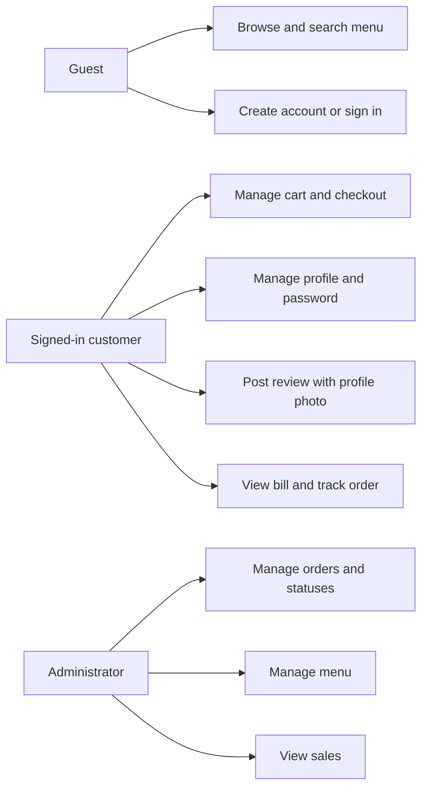
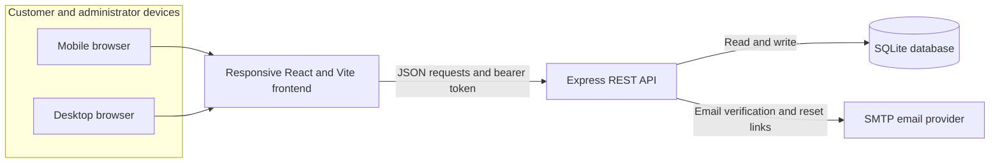

# Bistro Eleven — Week 12 Project Report

## 1. Project Overview

Bistro Eleven is a responsive restaurant ordering website. Customers can browse the menu, create an account, manage their profile, place orders, view bills, and track order progress. Restaurant administrators can manage the order queue and menu.

The application has a React/Vite frontend and an Express API. SQLite stores accounts, reviews, and orders. Passwords are stored as bcrypt hashes.

## 2. Updated Use Cases

### Customer using a phone

- Browse and search the menu on a mobile screen.
- Create an account or sign in; the cart is available after sign-in.
- Add dishes, review the cart, choose delivery or dine-in, and place an order.
- View the saved bill and follow order status from the customer dashboard.
- Update name, email, profile photo, phone, delivery address, and password in account settings.
- Verify an email and request a one-time password reset link if needed.
- Post a review after uploading a profile photo; that photo appears beside the review.

### Customer using a desktop browser

The customer can perform the same ordering, account, review, bill, and order-tracking tasks on a larger screen.

### Restaurant administrator

- Review incoming customer orders and change status to **New**, **Preparing**, **On the way**, **Completed**, or **Cancelled**.
- View customer order details and sales totals.
- Manage menu entries from the administrator dashboard.

## 3. System Architecture

The API owns password hashing and order persistence. A signed token identifies the authenticated account. The browser keeps the session token and theme preference; the shopping cart is held in memory. The API uses SMTP only for email verification and password recovery.

## 4. Main Pages and Features

| Page | Main features |
| --- | --- |
| Home (`#/`) | Hero, searchable menu, cart for signed-in customers, live reviews |
| Sign in (`#/login`) | Sign in, create account, show/hide password, forgot-password flow |
| Account (`#/account`) | Profile photo, name, email verification, phone, address, change password |
| Checkout (`#/checkout`) | Delivery/dine-in details, payment choice, kitchen loading animation, bill |
| Dashboard (`#/dashboard`) | Customer bills and order tracking; administrator order queue and sales |
| Reset password (`#/reset-password`) | Set a new password using a time-limited email link |

Customer reviews are stored in the backend. A customer must have a profile photo before posting a review.

## 5. Data and Configuration

The backend creates `backend/bistro.db` on first start. It stores users, profile fields, dishes, reviews, orders, and order items. Password reset and email verification use one-time tokens with expiration times; only token hashes are stored in SQLite.

Never commit `backend/.env` or `backend/bistro.db`. Keep `backend/.env.example` as the configuration template. The backend needs `JWT_SECRET`; sending verification and reset emails also needs SMTP settings. Set `APP_URL` to the frontend's reachable URL so emailed links open the site.

The local development administrator defaults to username `admin` and password `admin123`. Production requires private `ADMIN_USERNAME` and `ADMIN_PASSWORD` environment variables; do not publish those values.

For another laptop to access the same accounts and orders, deploy the frontend and API to reachable hosts and use one shared backend database with persistent storage. A `localhost` API is only reachable from the same computer.

## 6. Run Locally

1. Install frontend packages from the project root: `npm install`.
2. Copy the root `.env.example` to `.env` if the frontend API URL needs changing.
3. In `backend`, run `npm install` and copy `backend/.env.example` to `backend/.env`.
4. Set `JWT_SECRET` to a random value at least 32 characters long. Configure `SMTP_HOST`, `SMTP_PORT`, `SMTP_SECURE`, `SMTP_USER`, `SMTP_PASS`, and `SMTP_FROM` to enable email delivery. Set `APP_URL` to the frontend address printed by Vite.
5. Start the API from `backend` with `npm start` and leave that terminal open.
6. In a second terminal at the project root, run `npm run dev` and open the local URL Vite prints.

### Open the app on a phone

1. Connect the phone and development computer to the same Wi-Fi network.
2. Find the computer's IPv4 address with `ipconfig` (for example, `192.168.1.20`).
3. Start the API and Vite as above. Vite listens on the network so the phone can reach it.
4. On the phone, open `http://COMPUTER-IP:5173` (for example, `http://192.168.1.20:5173`). The frontend automatically calls the API on port `3001` at that same IP.
5. In Android Chrome, open the browser menu and choose **Install app** or **Add to Home screen**. On iPhone, open the page in Safari, tap **Share**, then **Add to Home Screen**.

Keep both development terminals running while using the app. For email verification or password reset links to open on the phone, set `APP_URL` in `backend/.env` to `http://COMPUTER-IP:5173` and restart the API. Windows Firewall may ask to allow Node.js on the private network. This local setup works only while both devices are on the same Wi-Fi; access from anywhere needs hosting with HTTPS.

### Hosting for access outside the local Wi-Fi

The frontend and backend must be hosted at public HTTPS addresses. Set `VITE_API_URL` to the hosted API URL when building the frontend. Set `APP_URL` to the hosted frontend URL in the backend. Set `JWT_SECRET`, `ADMIN_USERNAME`, and `ADMIN_PASSWORD`, and configure SMTP if account verification and password reset emails are needed. The backend accepts `DB_PATH`; point it at a persistent disk such as `/var/data/bistro.db`. Do not use an ephemeral filesystem for SQLite, because user accounts and orders can disappear after a restart or deploy. The existing laptop account is not copied automatically; create it again on the hosted site or migrate the database securely. Do not publish `.env` or `backend/bistro.db`.

Accounts need an email address and a password of at least 8 characters. An email must be verified before it can be used for password recovery. Profile photos must be PNG, JPG, or WebP, up to 3 MB. If installing `better-sqlite3` on Windows fails to find a compiler, install Visual Studio Build Tools with **Desktop development with C++**.

## 7. UI Design — Mobile Wireframes

These low-fidelity wireframes show the primary mobile customer flow: browse the menu, sign in, check out, update the account, and track an order.

The wireframes are planning views for narrow screens. The application pages use responsive CSS layouts for phone and desktop widths.

## 8. Week 12 Progress

### Assignment checklist

- [x] **Section 2 — Use Cases updated:** added the mobile customer use cases.
- [x] **Section 3 — System Architecture diagram:** added the frontend, API, database, and SMTP flow.
- [x] **Section 7 — UI Design:** added mobile wireframes for five customer screens.
- [x] **Section 8 — Progress updated:** recorded completed Week 12 changes below.

### Project changes completed

- Replaced browser-only account data with backend registration and login; password hashes are stored in SQLite.
- Added email verification, forgot-password/reset links, and change-password support.
- Added account settings for profile photo, name, email, phone, and delivery address.
- Gated cart and checkout behind customer sign-in.
- Persisted reviews, orders, order items, and status updates in the backend.
- Added bill history and customer order tracking; administrators can update order progress.
- Required a profile photo before a customer can post a review and show that photo beside the review.
- Added an animated kitchen loading state before checkout displays the bill.
- Added a hardcoded development administrator account and responsive mobile UI planning wireframes.

### Remaining deployment setup

- Configure a real SMTP sender before expecting verification or reset emails.
- Use a hosted frontend URL, API URL, and persistent shared database for cross-device access.
- Replace the hardcoded administrator credential before publishing the repository publicly.
